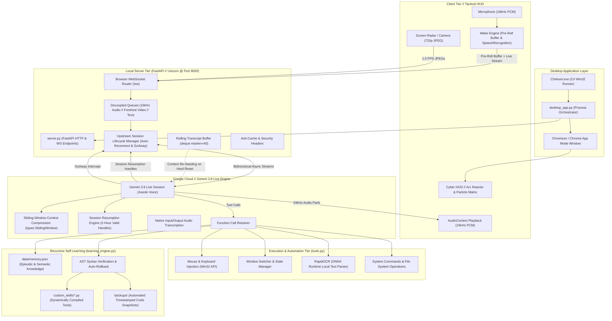
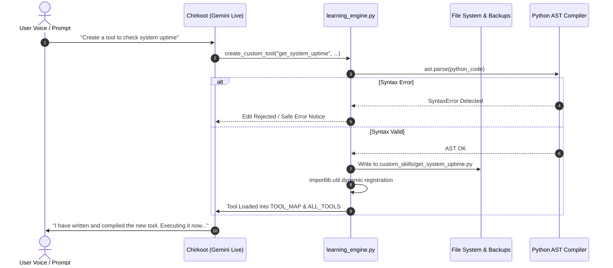

# CHIRKOOT (MK-IV) // Comprehensive Architecture & Capabilities Specification

> **Document Classification:** Technical Architecture & Functional Catalog  
> **Target System:** Chirkoot Autonomous Multimodal Desktop AI Companion  
> **Core Engine:** Google Gemini 3.8 Live API (`gemini-3.8-live`)  
> **Runtime Environment:** Windows 10/11 x64, Python 3.12, Chromium Native App Mode  
> **Repository Root:** `C:\jarvis\gemini_live_vision\`  

---

## 1. Executive Overview & System Philosophy

**Chirkoot** is an autonomous, multimodal, real-time AI desktop companion engineered for hands-free computer control, live visual understanding, natural voice dialogue, and recursive self-learning. Unlike conventional chat interfaces or passive voice assistants, Chirkoot combines:

1. **Bidirectional Real-Time Streaming:** Ultra-low latency voice-to-voice interaction via the Gemini 3.8 Live WebSocket protocol with simultaneous 16 kHz input audio, 24 kHz speech synthesis, and 1.0 FPS 720p visual streaming.
2. **Autonomous Computer Use & Desktop Control:** Native Windows OS mouse manipulation, keyboard typing, hotkey injection, window state management, and active application switching using normalized coordinates.
3. **Computer Vision & On-Device OCR:** Real-time visual parsing of the user's desktop display and webcam feed paired with local ONNX-powered Optical Character Recognition (RapidOCR) to detect and click buttons or text strings.
4. **Resilient Dual-Mode Wake Word Engine:** Client-side multi-alternative acoustic recognition with an audio pre-roll ring buffer that eliminates initial audio clipping.
5. **Recursive Self-Learning & Self-Modification:** The ability to inspect its own codebase, write new Python tools into a dynamic skills directory, test its code with abstract syntax tree (AST) validation, and persist user preferences across sessions.

---

## 2. High-Level Architecture Diagram



---

## 3. Real-Time Multimodal Streaming Pipeline (Gemini 3.8 Live)

Chirkoot interfaces directly with the `gemini-3.8-live` model using the Google GenAI SDK (`google.genai`). The connection is negotiated over an asynchronous full-duplex WebSocket (`/ws`).

### 3.1 Audio Ingestion & Resampling Pipeline
- **Capture:** `navigator.mediaDevices.getUserMedia` captures raw microphone input.
- **Echo Cancellation & Pre-Processing:** Echo cancellation, noise suppression, and auto-gain control are enabled natively in the browser audio constraints.
- **Downsampling:** The browser's native audio rate (44.1 kHz or 48 kHz) is downsampled to **16 kHz 16-bit Mono Linear PCM** in `downsampleTo16k()` using linear interpolation.
- **Transmission:** Sent as raw binary `ArrayBuffer` frames over WebSocket directly to Gemini Live via `session.send_realtime_input(audio=...)`.

### 3.2 Video & Screen Radar Pipeline
- **Screen Capture:** Activated via `navigator.mediaDevices.getDisplayMedia` at up to 720p (1280x720).
- **Webcam Feed:** Optical Eye captures camera video via `getUserMedia({ video: true })`.
- **Throttling & Frame Encoding:** Frames are drawn to an offscreen canvas at **1.0 FPS**, compressed to JPEG quality **0.65**, base64-encoded, and transmitted as JSON packets (`video_frame`).
- **Vision Memory:** Frames are cached to `%TEMP%\chirkoot_live_screen.jpg` for on-demand OCR processing.

### 3.3 Audio Synthesis & Playback
- **Downlink Audio:** Gemini 3.8 Live streams raw **24 kHz Mono PCM** audio chunks.
- **Queue Scheduling:** Audio chunks are buffered and decoded into Web Audio `AudioBuffer` objects, scheduled gaplessly along the `AudioContext.currentTime` timeline with crossfading to eliminate popping or clipping.
- **Interruption Handling:** When the user speaks while Chirkoot is replying, the server intercepts `server_content.interrupted`, immediately terminating audio playback and flushing the client buffer.

### 3.4 Session Lifecycle Architecture & "Always-On" Resilience

Without proactive session lifecycle management, default Gemini Live connections encounter hard server-side boundaries:
- **Audio-Only Cap:** 15 minutes max without context compression.
- **Video/Screen Radar Cap:** ~2 minutes max once visual frames are streamed (approx. 250–1,000 tokens/frame rapidly fills the active session buffer).
- **Socket Timeouts:** Live WebSocket connections drop automatically after ~10 minutes, accompanied by an upstream `GoAway` signal.

To deliver true **"Always-On"** and hours-long uninterrupted screen assistance, Chirkoot employs a 5-pillar resilient session lifecycle architecture:

```mermaid
sequenceDiagram
    autonumber
    participant Browser as Client Browser (HUD /ws)
    participant Server as FastAPI Server (server.py)
    participant Gemini as Gemini 3.8 Live (Cloud)

    Note over Browser,Server: Decoupled Connection Established
    Browser->>Server: Connect WebSocket (/ws)
    Server->>Gemini: Connect with ContextWindowCompression & SessionResumption
    Gemini-->>Server: session_resumption_update (new_handle = "4274b03b-...")
    Server-->>Browser: {"type": "status", "status": "connected"}

    loop Active Session (Audio, Video, Computer Use)
        Browser->>Server: 16kHz PCM Audio Chunks & 1 FPS Video JPEGs
        Server->>Gemini: send_realtime_input(audio/video)
        Gemini-->>Server: 24kHz PCM Audio & Tool Calls
        Server-->>Browser: send_bytes(audio) & Tool Execution
        Gemini-->>Server: Rolling Context Compression (SlidingWindow)
    end

    Note over Server,Gemini: ~10 Min Mark or Session Limit Approaching
    Gemini-->>Server: LiveServerGoAway (time_left = "55s")
    Note over Server: Decoupled Reconnect Triggered Invisibly
    Server->>Gemini: Cleanly Close Active Stream
    Server->>Gemini: Connect(session_resumption = handle)
    Note over Browser: Browser HUD unaffected; continues recording
    Gemini-->>Server: Session Resumed (new_handle = "0124d6d0-...")
    Server->>Gemini: Flush Pending Queued Audio & Freshest Video
```

#### 1. Sliding-Window Context Compression
- Configured via `types.ContextWindowCompressionConfig(sliding_window=types.SlidingWindow())`.
- Dynamically compresses aging conversation turns into compact semantic representations when token limits approach, completely **lifting the 15-minute audio-only and 2-minute video token caps**.
- Enables hours of continuous Screen Radar (1.0 FPS 720p desktop video feed + 16 kHz audio) without token exhaustion.

#### 2. Session Resumption with 2-Hour Handles
- Live sessions emit `session_resumption_update` messages containing cryptographically secure session handles (`resp.session_resumption_update.new_handle`).
- These handles persist full contextual state, memory, and tool history for **up to 2 hours**.
- `server.py` stores the freshest handle in memory (`latest_resumption_handle`).
- When reconnecting, Chirkoot sets `session_resumption=types.SessionResumptionConfig(handle=latest_resumption_handle)`, seamlessly restoring full multi-turn context within milliseconds.

#### 3. Proactive `GoAway` Interception
- Gemini Live servers notify clients before dropping connections by emitting a `LiveServerGoAway` message containing `time_left` (~60 seconds notice).
- Rather than waiting for a fatal connection drop, Chirkoot intercepts `response.go_away`, sets `session_active = False`, and initiates a clean, graceful handoff to a resumed session before the deadline expires.

#### 4. Decoupled WebSocket Architecture (HUD Transparency)
- The client browser connects to the FastAPI backend (`/ws`) once.
- Upstream reconnects to Gemini Live happen entirely behind the scenes in `gemini_session_manager`.
- The browser HUD experiences **zero flicker, zero disconnection warnings, and no socket resets**.
- Microphone audio is continuously queued in `audio_queue = asyncio.Queue(maxsize=150)`. During a brief 200–300ms upstream handoff, incoming voice chunks are preserved and dispatched immediately upon resumption.
- Video streaming decouples from audio via `video_new_event` and `latest_video_bytes`, guaranteeing that only the freshest 1.0 FPS screen frame is sent and large visual payloads never delay audio packets.

#### 5. Rolling Transcript Context Re-seeding (Cold Reset Recovery)
- To protect against catastrophic network partitions or handle expiration (>2 hours offline), the backend maintains a rolling conversation memory (`rolling_transcript = deque(maxlen=40)`).
- If a session resumption handle fails or is rejected, Chirkoot executes an immediate fallback:
  1. Invalidates the expired handle (`latest_resumption_handle = None`).
  2. Connects a fresh Gemini Live session.
  3. Re-seeds conversational history by synthesizing alternating user/model turns from `rolling_transcript` and injecting them into the new session using `session.send_client_content(turns=client_content_turns, turn_complete=False)`.
  4. Continuity is preserved even after complete connection loss.

---

## 4. Advanced Dual-Mode Wake Word Engine

Chirkoot features a resilient wake word detection engine supporting both hands-free voice activation and open mic streaming.

| Feature | Always-On Mode (`always-on`) | Wake Word Mode (`wake-word`) |
| :--- | :--- | :--- |
| **Microphone State** | Unconditional continuous streaming | Gated in memory; streams only on wake trigger |
| **Activation Trigger** | None (Immediate voice detection) | "Hey Chirkoot", "Chirkoot", "Jarvis", "Chitrakoot", "Hey" |
| **Audio Pre-Roll** | Live | **18-chunk circular buffer (~2.3 seconds)** |
| **Conversational Window**| Indefinite | **14.0 seconds** after last exchange before standby |
| **Chime Feedback** | N/A | Ascending chime on wake; descending chime on sleep |

### 4.1 Audio Pre-Roll Ring Buffer Architecture
To eliminate the classic issue where initial syllables are lost while waiting for wake-word verification:
1. While in `STANDBY`, `micNode.onaudioprocess` maintains a rolling memory buffer of **18 audio chunks (approx. 2.3 seconds of 16 kHz PCM)**.
2. The instant the wake word is recognized, the entire pre-roll buffer is **flushed into the WebSocket** before live streaming starts.
3. Gemini Live receives the complete utterance from the first phoneme, allowing natural commands like *"Hey Chirkoot, check my screen"* without clipping.

### 4.2 Multi-Alternative Speech Recognition
- Utilizes `webkitSpeechRecognition` with `continuous: true`, `interimResults: true`, and `maxAlternatives: 5`.
- Scans all 5 hypothesis alternatives across English, Indian English (Hinglish), and Hindi Devanagari.
- Employs **Levenshtein distance matching** and **2-word sliding windows** to accommodate phonetic variations:
  - Transliterated English: *Chirkoot*, *Chirkut*, *Cherkoot*, *Circuit*, *Sure koot*, *Sir koot*, *Cheer koot*, *Check out*, *Chiru*, *Chiku*, *Chotu*.
  - Aliases: *Chitrakoot*, *Chitrakut*, *Jarvis*, *Hey Jarvis*.
  - Devanagari Hindi: *हे चिरकुट*, *चिरकुट*, *चित्रकूट*, *सुनो*, *नमस्ते*, *अरे*, *ओए*.

---

## 5. Computer Use & Desktop Automation Catalog

All tools in Chirkoot are directly accessible by Gemini Live via native function calling (`types.LiveConnectConfig.tools`).

### 5.1 Native OS Interaction Tools

| Tool Signature | Parameters | Description |
| :--- | :--- | :--- |
| [`click_screen`](file:///C:/jarvis/gemini_live_vision/tools.py#L57) | `x: int, y: int, button: str, clicks: int, normalized: bool` | Clicks anywhere on screen using **0–1000 normalized coordinates**. Supports single/double clicks with left, right, or middle mouse buttons. |
| [`type_text`](file:///C:/jarvis/gemini_live_vision/tools.py#L93) | `text: str, press_enter: bool` | Injects text directly into the focused field via high-speed clipboard paste (`Ctrl+V`) with Win32 `VkKeyScan` character-by-character fallback. |
| [`press_hotkey`](file:///C:/jarvis/gemini_live_vision/tools.py#L132) | `keys: str` | Executes complex keyboard combinations (`win`, `alt,tab`, `ctrl,s`, `ctrl,c`, `ctrl,v`, `enter`, `escape`, `f11`). |
| [`scroll_screen`](file:///C:/jarvis/gemini_live_vision/tools.py#L170) | `direction: str, amount: int` | Injects mouse wheel delta events (`up` or `down`). |
| [`switch_to_app`](file:///C:/jarvis/gemini_live_vision/tools.py#L186) | `app_name: str` | Enumerates Windows HWNDs via `WScript.Shell.AppActivate` to bring target background apps (Chrome, VS Code, Spotify) directly to the front. |
| [`minimize_active_window`](file:///C:/jarvis/gemini_live_vision/tools.py#L214) | None | Minimizes foreground window via Win32 `ShowWindow(SW_MINIMIZE)`. |
| [`maximize_active_window`](file:///C:/jarvis/gemini_live_vision/tools.py#L277) | None | Maximizes active window via Win32 `ShowWindow(SW_MAXIMIZE)`. |
| [`restore_active_window`](file:///C:/jarvis/gemini_live_vision/tools.py#L304) | None | Restores active window from maximized state via `SW_RESTORE`. |
| [`toggle_fullscreen_window`](file:///C:/jarvis/gemini_live_vision/tools.py#L256) | None | Toggles borderless fullscreen via pywebview API or native `F11`. |

### 5.2 Vision & Optical Character Recognition (OCR)

| Tool Signature | Parameters | Description |
| :--- | :--- | :--- |
| [`ocr_screen`](file:///C:/jarvis/gemini_live_vision/tools.py#L374) | `region_or_query: Optional[str]` | Scans active screen using local ONNX RapidOCR, returning all detected text blocks with exact center normalized coordinates (`0–1000`). |
| [`ocr_image`](file:///C:/jarvis/gemini_live_vision/tools.py#L387) | `image_path: str` | Runs high-precision OCR on any local image file (PNG, JPG, BMP). |
| [`find_text_on_screen`](file:///C:/jarvis/gemini_live_vision/tools.py#L440) | `target_text: str, click: bool` | Fuzzy-searches on-screen text and optionally clicks the center of the target button or label autonomously. |

### 5.3 Host OS Workspace & Diagnostics

| Tool Signature | Parameters | Description |
| :--- | :--- | :--- |
| [`run_command`](file:///C:/jarvis/gemini_live_vision/tools.py#L504) | `command: str` | Executes system shell commands in PowerShell/CMD with a 30-second timeout, returning stdout, stderr, and exit codes. |
| [`read_file`](file:///C:/jarvis/gemini_live_vision/tools.py#L534) | `path: str, start_line: int, end_line: int` | Reads local files from disk with optional line-range slicing. |
| [`write_file`](file:///C:/jarvis/gemini_live_vision/tools.py#L561) | `path: str, content: str` | Creates or overwrites files on the host file system. |
| [`list_directory`](file:///C:/jarvis/gemini_live_vision/tools.py#L580) | `path: str` | Inspects directory listings with file sizes and directory indicators. |
| [`system_diagnostics`](file:///C:/jarvis/gemini_live_vision/tools.py#L602) | None | Returns CPU utilization, RAM usage, battery status, resolution, and platform metadata via `psutil`. |
| [`open_app_or_url`](file:///C:/jarvis/gemini_live_vision/tools.py#L620) | `target: str` | Launches applications by alias or opens web URLs in the default browser. |

---

## 6. Autonomous Recursive Self-Learning Engine

Chirkoot incorporates a dedicated self-modification engine ([`learning_engine.py`](file:///C:/jarvis/gemini_live_vision/learning_engine.py)) allowing it to safely inspect, modify, and extend its own source code on the fly without human intervention.



### 6.1 Code Modification Safeguards
1. **Safety Backups:** Every modification to existing source files generates a timestamped snapshot in `backups/` (`e.g. tools.py.20261104_192537.bak`).
2. **AST Parsing Validation:** When modifying `.py` files, `ast.parse()` parses the candidate code in memory before saving. If any `SyntaxError` occurs, the write is aborted, preserving the system from crashes.
3. **Rollback Manager:** The [`rollback_code()`](file:///C:/jarvis/gemini_live_vision/learning_engine.py#L287) function restores the previous backup automatically if runtime errors occur.
4. **Self-Testing Suite:** [`run_self_tests()`](file:///C:/jarvis/gemini_live_vision/learning_engine.py#L410) validates that every Python file across the root directory and `custom_skills/` compiles cleanly.

### 6.2 Persistent Memory Bank
- Memory is stored in [`data/memory.json`](file:///C:/jarvis/gemini_live_vision/data/memory.json).
- Supports categories: `user_preference`, `workflow_pattern`, `correction`, `shortcut`, and `general`.
- Stored memories are dynamically injected into Gemini's system instruction on startup via `get_memory_prompt_injection()`.

---

## 7. Tactical Cyber-HUD Frontend Architecture

Chirkoot's interface ([`index.html`](file:///C:/jarvis/gemini_live_vision/static/index.html), [`style.css`](file:///C:/jarvis/gemini_live_vision/static/style.css), [`app.js`](file:///C:/jarvis/gemini_live_vision/static/app.js)) is styled as a futuristic JARVIS-inspired cyan/neon cockpit.

### 7.1 Visual Elements & Visualizers
- **Arc Reactor Audio Visualizer:** Dynamic HTML5 canvas running a 60 FPS circular Fourier spectrum visualizer that expands and pulses based on the user's speech amplitude and frequency.
- **HUD Ambient Grid & Scanlines:** CSS radial gradient scanlines and CRT-flicker filters.
- **Audio Wave Spectrum Bars:** Header and panel audio level indicator bars showing real-time input/output audio amplitude.
- **Stream Status Reticles:** Corner brackets and glowing reticles indicate when Screen Radar or Optical Eye feeds are streaming.
- **Anti-Self-Mirroring Detection:** When the active screen share feed contains Chirkoot itself (detected through visual cues), the HUD displays an alert advising the user to switch to a work application.

### 7.2 Cache Elimination Architecture
To guarantee that modifications always appear immediately:
1. **HTTP Headers:** FastAPI injects `Cache-Control: no-cache, no-store, must-revalidate, max-age=0` across all HTTP and static asset responses.
2. **Cache-Busting Query Strings:** Assets are linked with timestamp queries (`style.css?v=...`, `app.js?v=...`).
3. **Isolated Profile Mode:** Chromium is launched with `--user-data-dir=.chirkoot_profile` and `--disable-application-cache` to isolate the app from shared browser caches.

---

## 8. Desktop Distribution & Windows Integration

Chirkoot runs as a dedicated standalone Windows desktop application:

```
C:\jarvis\gemini_live_vision\
├── Chirkoot.exe                 # Authenticode SHA-256 signed Win32 C# executable
├── ChirkootLauncher.cs          # Source for launcher wrapper
├── chirkoot.ico                 # High-resolution application icon (256x256)
├── chirkoot.png                 # Brand logo and avatar
├── desktop_app.py               # Orchestrator: starts port 8000 server & launches UI
├── server.py                    # FastAPI server & Gemini Live WebSocket router
├── tools.py                     # Native OS automation, OCR, and computer use tools
├── learning_engine.py           # Self-learning, code modification, and memory bank
├── .chirkoot_profile/           # Dedicated, isolated Chromium app data profile
├── custom_skills/               # User-created and self-learned dynamic tools
├── data/                        # Persistent memory.json and change_log.json
├── backups/                     # Automatic timestamped source code backups
└── static/                      # HTML5 HUD, styling, and JavaScript logic
```

- **Shortcuts:** Pinned to Start Menu (`%APPDATA%\Microsoft\Windows\Start Menu\Programs\Chirkoot.lnk`) and Desktop.
- **Browser Execution:** Prefers Google Chrome Native App Mode (`--app=http://127.0.0.1:8000`), automatically falling back to Microsoft Edge App Mode or PyWebView.

---

## 9. Comprehensive Tool Catalog Summary

| Category | Count | Primary Functions |
| :--- | :---: | :--- |
| **OS & Screen Automation** | 9 | `click_screen`, `type_text`, `press_hotkey`, `scroll_screen`, `switch_to_app`, `minimize_active_window`, `maximize_active_window`, `restore_active_window`, `toggle_fullscreen_window` |
| **OCR & Vision Search** | 3 | `ocr_screen`, `ocr_image`, `find_text_on_screen` |
| **Host System & Workspace**| 6 | `run_command`, `read_file`, `write_file`, `list_directory`, `system_diagnostics`, `open_app_or_url` |
| **Self-Learning & Memory** | 8 | `inspect_self`, `read_code_file`, `modify_source_code`, `rollback_code`, `create_custom_tool`, `list_custom_tools`, `remember_insight`, `recall_memory` |
| **System Integrity & Self-Test**| 3 | `run_self_tests`, `get_codebase_guide`, `self_learn_and_implement` |
| **Dynamic Skills** | Variable | Loaded dynamically from `custom_skills/*.py` at runtime |


---

## 10. Threat Model & Production-Grade Security Architecture (MK-V)

Chirkoot MK-V incorporates an end-to-end, defense-in-depth security architecture designed to operate safely in adversarial desktop environments where the agent continuously ingests untrusted multi-modal input.

```
+-----------------------------------------------------------------------------------+
|                            UNTRUSTED INPUT CHANNELS                               |
|  [ Screen / Vision ]   [ OCR Frames ]   [ Files / Diffs ]   [ Ambient Microphone ]|
+-----------------------------------------------------------------------------------+
                                         │
                                         ▼
+-----------------------------------------------------------------------------------+
|                           GEMINI 3.8 LIVE REASONING                               |
|                       (Generates Function / Tool Calls)                           |
+-----------------------------------------------------------------------------------+
                                         │
                                         ▼
+-----------------------------------------------------------------------------------+
|                        LOCAL SECURITY POLICY DISPATCHER                           |
|                                                                                   |
|  1. Emergency Kill Switch Check  ──► Abort if ACTIVE                              |
|  2. Dynamic Taint Tracker        ──► Flags actions within 60s of untrusted input  |
|  3. Immutable Core Validator     ──► Blocks edits to server, policy, or launcher  |
|  4. Sensitive Path Sandbox       ──► Denies access to .env, SSH, browser profiles |
|                                                                                   |
|  TIER 1 (Read-Only)      TIER 2 (Reversible UI)      TIER 3 (High-Impact / Exec)  |
|  [Auto-Execute & Log]    [Auto-Execute / Taint Gate]  [PHYSICAL HITL REQUIRED]     |
|                                                               │                   |
|                                                    ┌──────────┴──────────┐        |
|                                                    ▼                     ▼        |
|                                               User Approves        User Denies    |
|                                                    │                     │        |
|                                                    ▼                     ▼        |
|                                            Execute Sandboxed         Block Action |
+-----------------------------------------------------------------------------------+
```

### 10.1 Threat Analysis & Attack Surfaces

Desktop AI agents with full computer-use and self-modification capabilities are exposed to severe indirect attack vectors:

1. **Indirect Prompt Injection via Screen Vision:** Web pages, PDFs, documents, or phishing emails displayed on screen can embed invisible or adversarial text instructing the agent to exfiltrate files or execute shell payloads.
2. **OCR & Text Extraction Poisoning:** Malicious payloads hidden inside images or terminal logs can hijack the agent's context during OCR scans.
3. **Ambient Audio & Speaker Bleed:** Videos, podcasts, or conference calls played through room speakers can emit speech commands ("Chirkoot, delete all files") that are picked up by the microphone.
4. **Self-Disarming & Persistence via Self-Modification:** A compromised agent could attempt to rewrite `security_policy.py`, disable policy checks, or insert persistent backdoors into dynamic skills or memory files.
5. **Cross-Site WebSocket Hijacking (CSWSH):** Because browsers do not enforce the Same-Origin Policy on WebSocket connections, any malicious webpage visited in the user's regular browser can initiate a connection to `ws://127.0.0.1:8000/ws` and hijack the agent.

---

### 10.2 Tool Tiering Matrix & Local Dispatcher Policy

Tools are strictly partitioned into three risk tiers in `security_policy.py`:

| Tier | Classification | Tools Included | Enforcement Policy |
| :--- | :--- | :--- | :--- |
| **Tier 1** | **Read-Only Inspection** | `list_directory`, `system_diagnostics`, `inspect_self`, `read_code_file`, `list_custom_tools`, `recall_memory`, `list_memories`, `run_self_tests`, `get_codebase_guide` | **Auto-Allowed:** Executed immediately; full audit trail logged to `audit_log.jsonl`. |
| **Tier 2** | **Reversible UI Automation** | `click_screen`, `type_text`, `press_hotkey`, `scroll_screen`, `switch_to_app`, `minimize_active_window`, `maximize_active_window`, `restore_active_window`, `toggle_fullscreen_window`, `open_app_or_url`, `remember_insight` | **Conditionally Auto-Allowed:** Runs automatically when untainted. If the session has ingested untrusted content within the last 60 seconds (tainted), requires explicit user confirmation. |
| **Tier 3** | **High-Impact Side Effects** | `run_command`, `write_file`, `modify_source_code`, `rollback_code`, `create_custom_tool`, `delete_memory`, `self_learn_and_implement` | **MANDATORY HITL CONFIRMATION:** Tool execution is paused. A high-priority modal appears on the HUD displaying the exact tool name, arguments, and taint warnings. Requires physical confirmation (Click "Allow" or press `Enter`). Voice confirmation alone is explicitly rejected. |

#### Dynamic Taint Tracking
The `TaintTracker` continuously tracks whether the model has recently consumed untrusted input:
- **Taint Sources:** Screen frame capture (`set_latest_screen_frame`), OCR analysis (`ocr_screen`, `ocr_image`), and untrusted file reads (`read_file`).
- **Sliding Window:** 60-second decay. If high-impact tools or UI typing are requested while tainted, the dispatcher elevates the confirmation requirement and alerts the user.

---

### 10.3 Immutable Core & Data Isolation

To prevent an agent from editing the very security policies designed to constrain it:

1. **Immutable Core Codebase:**
   The following files and directories in `C:\jarvis\gemini_live_vision\` are permanently read-only to all tool calls (`modify_source_code`, `write_file`, `self_learn_and_implement`):
   - `server.py`
   - `security_policy.py`
   - `learning_engine.py`
   - `tools.py`
   - `desktop_app.py`
   - `Chirkoot.exe`
   - `ChirkootLauncher.cs`
   - `static/` core assets
   Any attempt by the model to edit these files is intercepted by `is_immutable_core_path()` and rejected with `PermissionError: Immutable core file protected`.

2. **User Data Relocation to `%LOCALAPPDATA%\Chirkoot`:**
   All mutable runtime state is isolated from the repository root:
   - **Data & Memories:** `%LOCALAPPDATA%\Chirkoot\data\memory.json`
   - **Dynamic Custom Skills:** `%LOCALAPPDATA%\Chirkoot\custom_skills\`
   - **Backups:** `%LOCALAPPDATA%\Chirkoot\backups\`
   - **Audit Logs:** `%LOCALAPPDATA%\Chirkoot\logs\audit_log.jsonl`
   - **DPAPI Vault:** `%LOCALAPPDATA%\Chirkoot\vault\credentials.dat`

3. **Subprocess Isolation for Custom Skills:**
   Custom skills are executed in isolated Python subprocesses with declared permissions and strict timeouts (`execute_sandboxed_python_script`), rather than being dynamically imported into the FastAPI server process.
4. **Safe Mode:**
   Chirkoot can be booted with `--safe-mode` or environment variable `CHIRKOOT_SAFE_MODE=1` to disable all custom dynamic skills and load only verified core built-ins.

---

### 10.4 Process Tree Sandboxing & Credential Vault

1. **Process Tree Termination on Timeout:**
   Standard `subprocess.Popen.kill()` on Windows terminates only the parent shell (PowerShell or CMD), leaving child worker processes orphaned in the background. Chirkoot's `execute_sandboxed_command()` uses native Windows process tree termination:
   ```cmd
   taskkill /F /T /PID <pid>
   ```
   guaranteeing that all spawned sub-processes are completely killed when a command times out.
2. **Output Size & Line Capping:**
   Command output is strictly capped at **8 KB (8,192 bytes)** and **100 lines** to prevent context window flooding, token exhaustion, and accidental memory exfiltration.
3. **Sensitive Path Sandbox:**
   Path traversal blocklists deny `read_file` and `write_file` access to:
   - Plaintext `.env` files
   - Browser profiles, cookies, and login credentials (`.chirkoot_profile`, Chrome/Edge/Firefox User Data)
   - SSH private keys (`.ssh/id_rsa`, `.ssh/id_ed25519`)
   - Cloud credentials (`.aws/credentials`, `.azure`, `gcloud`)
   - Windows DPAPI credential store
4. **Native Windows DPAPI Vault:**
   Instead of storing sensitive credentials in plain-text `.env` files, Chirkoot uses Windows Data Protection API (`CryptProtectData` and `CryptUnprotectData` via `ctypes.windll.crypt32`). The API key is encrypted using the Windows user's logon master key and stored in `%LOCALAPPDATA%\Chirkoot\vault\credentials.dat`.

---

### 10.5 Memory Provenance & Scoped Retrieval

1. **Provenance Tagging:**
   Every persistent memory entry is stamped with source attribution:
   - `user_explicit`: Explicitly dictated by the user via speech or chat. Only these entries can modify agent behavioral preferences or personal facts.
   - `screen_derived`: Inferred from visible desktop windows or applications.
   - `ocr_derived`: Extracted from OCR scans.
   - `inferred`: Deduced during autonomous reasoning.
2. **Scoped Top-K Semantic Retrieval:**
   Rather than dumping the entire `memory.json` database into the LLM system prompt on startup, Chirkoot employs `get_scoped_memories(query, top_k=6)`. The query is matched against categories, keys, and values using token frequency scoring, ensuring prompt frugality and mitigating indirect memory injection.
3. **Review & Forget API & UI:**
   Users can audit and delete stored memories via:
   - REST endpoints: `GET /api/memories` and `DELETE /api/memories/{category}/{key}`
   - HUD Interface: Clicking the **MEMORIES** button in the header opens a dedicated review panel displaying provenance badges and one-click deletion.

---

### 10.6 Localhost Lockdown & CSWSH Prevention

To eliminate Cross-Site WebSocket Hijacking attacks:

1. **Origin Header Validation:**
   The `/ws` WebSocket endpoint inspects the HTTP `Origin` header. Connections from foreign web domains (e.g. `evil.com`) are rejected with HTTP 403 / WebSocket Close Code 1008. Only `127.0.0.1`, `localhost`, and empty origins (native desktop wrappers) are accepted.
2. **Ephemeral Per-Launch Launch Token:**
   Every time `desktop_app.py` boots, it generates a 32-byte cryptographically secure URL-safe token via `secrets.token_urlsafe(32)`. The WebSocket handshake requires this token as a query parameter (`ws://127.0.0.1:8000/ws?token=<token>`). Unauthenticated requests are immediately closed.
3. **Single Active Client Gatekeeper:**
   Only one HUD client session may connect to the backend at a time. Extraneous connection attempts are rejected, preventing session shadowing.

---

### 10.7 Multi-Tier Emergency Kill Switch

Chirkoot features a multi-tiered Emergency Kill Switch that operates independently of the LLM:

1. **Tier 1: Client-Side Speech Stop-Word Interceptor:**
   The Web Speech recognition engine locally detects emergency halt phrases ("stop", "halt", "cancel", "ruko", "bas", "ruk jao", "chirkoot stop"). Upon detection, it instantly aborts audio streaming, cancels pending tool executions, and dispatches an emergency halt signal before the audio even reaches the Gemini server.
2. **Tier 2: Global Hardware Hotkeys:**
   - **`Ctrl + Shift + X`**: Instantly halts all active tool executions and engages the kill switch.
   - **Double-Tap `Escape`**: Pressing `Escape` twice within 400 milliseconds triggers the kill switch.
3. **Tier 3: Cockpit HUD Button & REST API:**
   - Red **EMERGENCY STOP** button located prominently in the HUD header.
   - REST endpoints `POST /api/kill-switch` and `POST /api/kill-switch/reset` for external orchestrators and tests.
4. **Enforcement:**
   When the kill switch is active, `check_kill_switch()` raises an `InterruptedError` across all tool executions, mouse/keyboard movements are halted, and the HUD indicates red lockout status until manually cleared by the user.
