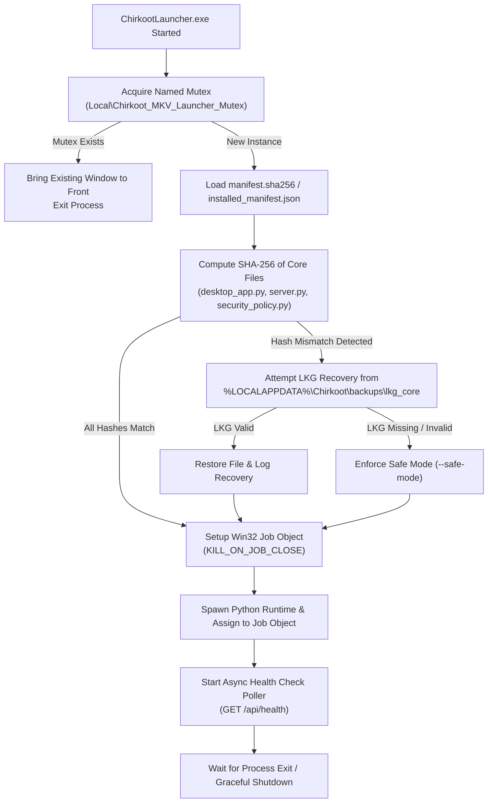

# Chirkoot MK-V: Packaging, Distribution & Deployment Architecture Evaluation

## Executive Summary

This document evaluates the deployment and distribution architecture for **Chirkoot MK-V Multimodal Desktop Assistant** on Microsoft Windows. It compares runtime packaging strategies, details cryptographic dependency and manifest verification, analyzes the security boundary between the native C# launcher and loose Python runtime files, and formalizes the separation of protected application code from mutable user data.

---

## 1. Runtime Packaging Strategy Evaluation

| Criterion | Alternative A: Bundled Embedded Python (`python-embed-amd64`) | Alternative B: PyInstaller One-File Bundle | Alternative C: System Python Discovery |
| :--- | :--- | :--- | :--- |
| **Footprint** | ~35 MB base runtime; ~90 MB with pre-installed wheels | ~140–180 MB single `.exe` | 0 MB installer overhead (uses existing host runtime) |
| **Cold Start Latency** | **Instant (< 300 ms)** — direct execution from disk | **Slow (3–8 seconds)** — must decompress full archive into `%TEMP%\_MEIxxxxxx` on every launch | Variable (< 500 ms) |
| **Antivirus / EDR Impact** | **Low** — standard portable binary distribution | **High** — one-file packers frequently trigger false-positive Trojan/heuristic detections in Windows Defender | Low |
| **Update Granularity** | **Differential** — individual `.py` files and wheels can be patched via staged ZIP updates (< 5 MB) | **Monolithic** — every bugfix requires re-downloading and replacing the entire 180 MB binary | Dependent on external pip environment |
| **Tamper Resistance** | Protected via Launcher pre-launch SHA-256 verification and Windows DACLs | Unpacked temp directory (`%TEMP%\_MEIxxxx`) is susceptible to TOCTOU symlink / race attacks | High risk of environment corruption or package collisions |
| **Packaging Complexity** | Moderate (requires configuring `python312._pth` and pre-installing wheels) | High (hook configuration, hidden imports, C-extension bundling) | Very low |

### Recommendation
**Alternative A (Embedded Python Runtime + C# Native Launcher)** is the selected distribution architecture for production deployments:
1. `ChirkootLauncher.exe` first probes for a bundled runtime in `.\python_runtime\python.exe` or `.\python-embed\python.exe`.
2. If absent (development environment), it automatically falls back to local user installations in `%LOCALAPPDATA%\Programs\Python\Python312` and system `PATH`.
3. This delivers the speed and differential update efficiency of embedded runtimes while preserving developer flexibility.

---

## 2. Security Model: C# Launcher vs. Loose Python Files

### The Vulnerability of Signed Launchers with Loose Scripts
In Windows software distribution, developers often digitally sign a native wrapper executable (e.g., `ChirkootLauncher.exe` with Authenticode) while distributing application logic as loose `.py` or `.pyc` files in the application folder.

> [!WARNING]
> A signed C# executable does **NOT** cryptographically protect or validate loose script files launched by it. Without explicit pre-launch verification, an attacker, untrusted tool, or malware with write access to the filesystem could modify `desktop_app.py`, `server.py`, or `security_policy.py`, and the signed launcher would execute the compromised code with full user permissions.

### Chirkoot MK-V Cryptographic Pre-Launch Verification
To close this integrity gap, `ChirkootLauncher` enforces strict cryptographic validation:
1. **Cryptographic Manifest**:
   - `manifest.sha256` and `installed_manifest.json` contain golden SHA-256 hashes of all application files.
   - Updates are distributed with RSA-PSS signed manifests (`update_manifest.json`) verified against the developer's public key.
2. **Pre-Launch Integrity Sweep**:
   - Prior to spawning Python, `ChirkootLauncher` computes streaming SHA-256 hashes of `desktop_app.py`, `server.py`, `security_policy.py`, and `learning_engine.py`.
   - Hashes are compared against `manifest.sha256`.
3. **Automated Last-Known-Good (LKG) Recovery**:
   - If any core file hash does not match, the launcher reports a critical integrity alert.
   - It automatically attempts to restore the corrupted file from `%LOCALAPPDATA%\Chirkoot\backups\lkg_core`.
   - If recovery succeeds, execution continues normally.
   - If recovery fails, the launcher appends `--safe-mode`, disabling all dynamic learning, custom skills, and destructive actions.



---

## 3. Dependency Pinning & Hash Verification Strategy

To defend against supply-chain attacks, dependency confusion, and malicious package injection, Chirkoot MK-V pins all third-party dependencies using pip's cryptographic hash verification (`--require-hashes`).

### Pinned Requirements Format
```text
# requirements.txt
fastapi==0.115.0 \
    --hash=sha256:d55f464522d0bba6d214c77174ba1a88b1b0b5dc00b467ecbe776d6c6d0426b6
uvicorn==0.30.6 \
    --hash=sha256:4d603a1fc6c98687ba17f7396c21e6490890bf661f0fc2281a1795c6978586c0
cryptography==43.0.1 \
    --hash=sha256:2fa9f454f7678f566412e61df1f6305a2dfdf4d2ec8a7e0d37e6da3cf5766eec
websockets==12.0 \
    --hash=sha256:1a84f3e6955c48bce955e82b7db5c2494ea4e8d3886f7b7cb2ff2b38fb9f46ee
```

### Installation Command
```powershell
python -m pip install --require-hashes -r requirements.txt
```
Any package whose downloaded wheel or tarball does not match the pinned SHA-256 hash is immediately rejected by pip, guaranteeing reproducible and tamper-proof builds.

---

## 4. Separation of Application Code and Mutable User Data

Chirkoot strictly isolates immutable application code from mutable user data:

```
Installation Directory (Read-Only / Protected)
C:\Program Files\Chirkoot\  or  C:\jarvis\gemini_live_vision\
├── ChirkootLauncher.exe         <- Native C# Launcher
├── ChirkootLauncher.cs          <- Source code
├── desktop_app.py               <- Tactical HUD entrypoint
├── server.py                    <- FastAPI backend
├── security_policy.py           <- Security kernel
├── learning_engine.py           <- Protected engine code
├── manifest.sha256              <- SHA-256 cryptographic hashes
├── installed_manifest.json      <- JSON metadata & file inventory
└── ...

User Data Directory (Mutable User & Agent Area)
%LOCALAPPDATA%\Chirkoot\
├── data\                        <- SQLite memory.db, FTS5 index, vector store
├── logs\                        <- Daily rotating audit logs & launcher.log
├── config\                      <- User settings, startup_health.json
├── backups\
│   └── lkg_core\                <- Last-Known-Good verified application snapshot
├── staging\                     <- Cryptographically verified update staging
├── browser_profile\             <- Chromium user data dir, cache & cookies
├── temp\                        <- Ephemeral in-memory frame buffers
├── vault\                       <- DPAPI / Windows Credential Manager encrypted secrets
└── custom_skills\               <- User-approved self-learned dynamic skills
```

> [!IMPORTANT]
> The application installation directory contains **zero mutable databases, logs, or cache files**. During application uninstallation, all application binaries and scripts can be purged without destroying the user's memory, preferences, or conversation logs in `%LOCALAPPDATA%\Chirkoot`.

---

## 5. Staged Update Lifecycle & Automatic Rollback

1. **Download & Staging**: Update packages are extracted into `%LOCALAPPDATA%\Chirkoot\staging`.
2. **Signature & Checksum Verification**:
   - Manifest digital signature is verified using RSA-PSS SHA-256 against the trusted developer public key.
   - All extracted payload files are checked against manifest SHA-256 hashes.
   - Zip slip path traversal attacks are rejected.
3. **LKG Snapshot**: The current working installation is snapshotted into `backups\lkg_core`.
4. **Atomic Application**: Staged files are copied to the installation directory.
5. **Post-Update Health Check**:
   - The launcher boots the updated backend and queries `http://127.0.0.1:8000/api/health`.
   - If the endpoint returns `{"status": "ok"}` within 15 seconds, the update is committed.
   - If the backend crashes or fails health verification, **automatic rollback** immediately restores all files from `backups\lkg_core`.
