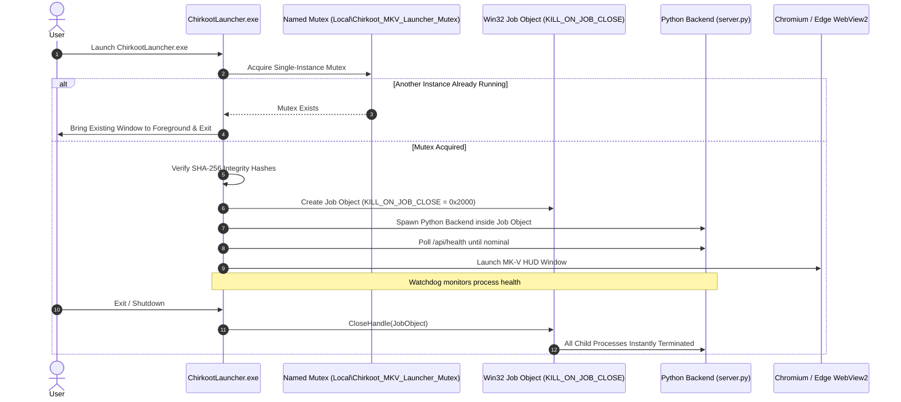

# Chirkoot MK-V: Production Windows Deployment & Operational Guide

**System Target:** Windows 10 (Build 19041+ / Version 2004+) and Windows 11 (64-bit AMD64)  
**Distribution Model:** Native C# Hardened Launcher + Embedded Python Runtime (`python-3.12.7-embed-amd64`)  
**Security Policy:** Strict Immutability & Application / User Data Separation  

---

## 1. System Architecture & Directory Layout

To guarantee complete application immutability and prevent agent self-modification attacks, Chirkoot MK-V strictly separates the immutable read-only application code from the mutable user data directory:

```
[SYSTEM DRIVE (C:)]
├── Program Files / Application Core (READ-ONLY to Agent)
│   └── C:\jarvis\gemini_live_vision\
│       ├── ChirkootLauncher.exe          <-- Native C# Launcher (Job Object, Mutex, Watchdog)
│       ├── server.py                     <-- Core FastAPI / WebSocket server
│       ├── desktop_app.py                <-- Desktop GUI entrypoint
│       ├── security_policy.py            <-- Security Kernel & Taint Tracker
│       ├── dispatcher.py                 <-- 3-Tier Multi-turn Function Dispatcher
│       ├── closed_loop_verifier.py       <-- Closed-Loop Desktop Action Verifier
│       ├── desktop_automation.py         <-- Windows UI Automation COM & OCR Engine
│       ├── emergency_stop.py             <-- Independent Emergency Kill Switch
│       ├── learning_engine.py            <-- Autonomous SDLC & Skill Lifecycle Engine
│       ├── deployment_manager.py         <-- Staged Updates & Manifest Cryptography
│       ├── installed_manifest.json       <-- SHA-256 Hashes of all application files
│       ├── manifest.sha256               <-- Flat cryptographic checksums
│       ├── static/                       <-- MK-V Tactical Cyber Command Interface HUD
│       └── tests/                        <-- Unified 19-Suite Regression Test Matrix
│
└── %LOCALAPPDATA%\Chirkoot\ (MUTABLE User Directory)
    ├── config/                           <-- User settings, active skills catalog
    ├── memory/                           <-- Persistent SQLite memory (memory.db, WAL)
    ├── skills/                           <-- Active & staged user custom skills
    │   ├── active/                       <-- Approved custom skills
    │   ├── staging/                      <-- Candidate skills awaiting on-screen approval
    │   └── quarantine/                   <-- Malicious or crashing quarantined skills
    ├── logs/                             <-- Redacted execution logs and audit events
    ├── backups/                          <-- Last-Known-Good (LKG) core rollbacks
    ├── updates/                          <-- Staged update packages
    └── temp/                             <-- Sandboxed transient scratch files
```

---

## 2. Prerequisites & Host Requirements

1. **Operating System:** Windows 10 Build 19041 (Version 2004) or later, or Windows 11 (64-bit).
2. **Architecture:** x86_64 / AMD64.
3. **Display:** DirectX 11 compatible display adapter (hardware GPU or virtualized 3D surface).
4. **Network:** Internet access for Gemini 3.8 Live WebSocket API (`wss://generativelanguage.googleapis.com`).
5. **Privileges:** Standard user privileges (administrative privileges are **NOT** required and should not be used).

---

## 3. Packaging & Installation Steps

### Step 1: Provisioning the Embedded Python Environment
1. Download the official Windows embedded Python package: `python-3.12.7-embed-amd64.zip`.
2. Extract to `C:\jarvis\gemini_live_vision\python_runtime\`.
3. Enable site-packages by uncommenting `import site` in `python312._pth`.
4. Install pinned production dependencies:
   ```powershell
   .\python_runtime\python.exe -m pip install -r requirements.txt
   ```

### Step 2: Compiling the Native C# Hardened Launcher
Compile `ChirkootLauncher.cs` using Microsoft Roslyn C# Compiler (`csc.exe`) included with Windows .NET Framework:
```powershell
C:\Windows\Microsoft.NET\Framework64\v4.0.30319\csc.exe `
    /target:winexe `
    /out:ChirkootLauncher.exe `
    /win32icon:static\icon.ico `
    /optimize+ `
    ChirkootLauncher.cs
```

### Step 3: Generating Cryptographic Integrity Manifests
Run the deployment manager to generate SHA-256 hashes of all core files:
```powershell
python deployment_manager.py --generate-manifest
```
This produces `installed_manifest.json` and seeds the baseline Last-Known-Good (LKG) backup in `%LOCALAPPDATA%\Chirkoot\backups\lkg_core\`.

---

## 4. Credential Management via Windows DPAPI

Chirkoot MK-V **never** stores API keys in plaintext environment files (`.env`) or plaintext JSON. All credentials are encrypted using the native Windows Data Protection API (DPAPI) and tied to the user's logged-in Windows security principal:

### Storing Credentials via Command Line
```powershell
python -c "import security_policy as sp; sp.store_secret_dpapi('GEMINI_API_KEY', 'AIzaSyYourActualKeyHere')"
```

### Automatic Prompt in HUD
When launching for the first time, if no key is present in the DPAPI vault, the Central Assistant ribbon in the HUD will prompt for secure entry and store it in the DPAPI vault automatically.

---

## 5. Process Lifecycle & Hardening Features



### Key Launcher Guarantees:
1. **Single-Instance Enforcement:** Protected by Win32 Named Mutex `Local\Chirkoot_MKV_Launcher_Mutex`. Re-launching brings the active HUD to the foreground.
2. **Zero Orphaned Processes:** Every child process (Python, ffmpeg, background workers) is registered with a Win32 Job Object configured with `JOB_OBJECT_LIMIT_KILL_ON_JOB_CLOSE (0x2000)`. Closing the launcher immediately kills all subprocesses.
3. **Pre-Launch Hash Verification:** Pre-calculates SHA-256 checksums of core `.py` files. If tampering or corruption is detected, automatically triggers Last-Known-Good (LKG) restoration.
4. **Crash Loop Watchdog:** If the backend crashes > 3 consecutive times within 60 seconds, boots into Safe Mode (`--safe-mode`) with custom skills disabled.

---

## 6. Staged Updates & Rollback Procedure

Chirkoot MK-V provides atomic, cryptographically verified updates:

```powershell
# Stage and verify an update package
python deployment_manager.py --stage-update "C:\path\to\update_v5.1.0.zip"

# Apply staged update with automatic LKG backup
python deployment_manager.py --apply-update

# Rollback to Last-Known-Good version if needed
python deployment_manager.py --rollback-lkg
```

---

## 7. Clean Uninstallation

To remove all traces of Chirkoot MK-V:
```powershell
# Complete uninstall (removes application and %LOCALAPPDATA%\Chirkoot)
python deployment_manager.py --uninstall --purge-user-data
```
