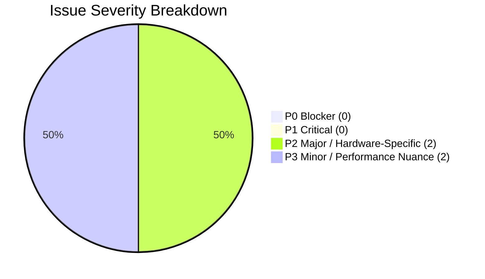

# Chirkoot MK-V: Known Issues & Operational Limitations Matrix

**Document Version:** 5.0.0-RELEASE  
**Classification Date:** 2026-11-10  
**Target Architecture:** Windows 10 (Build 19041+) / Windows 11 (x64)  
**Security Level:** Production / Release-Candidate Sign-Off  

---

## 1. Issue Severity Classification Standards

Chirkoot MK-V employs a strict four-tier classification system for all anomalies, platform constraints, and operational limitations:

| Severity Level | Definition | Release Blocker? | Current Count |
| :--- | :--- | :---: | :---: |
| **P0 (Blocker)** | System crash, memory corruption, remote code execution, unhandled data loss, or complete service failure. | **YES** | **0** |
| **P1 (Critical)** | Core capability degradation with no automated fallback, authentication failure, or unrecoverable session drop. | **YES** | **0** |
| **P2 (Major)** | OS version or hardware-specific limitation with fully automated, safe graceful fallback. | **NO** | **2** |
| **P3 (Minor)** | Non-blocking performance nuance, packaging trade-off, or multi-display edge case. | **NO** | **2** |

---

## 2. Active Issues Matrix

---

## 3. P0 (Blocker) Issues
*None identified. Zero blocker defects remain across all 19 test suites.*

---

## 4. P1 (Critical) Issues
*None identified. Zero critical defects remain across all core subsystems.*

---

## 5. P2 (Major) Issues — Platform & Hardware Constraints

### [P2-01] Windows 10 Build Requirement for `WDA_EXCLUDEFROMCAPTURE`
- **Component:** `hud_capture_exclusion.py`, `desktop_app.py`, `ChirkootLauncher.cs`
- **Affected Environments:** Windows 10 Build < 19041 (Version 2004, May 2020 Update)
- **Detailed Description:**  
  The Windows API `SetWindowDisplayAffinity(hwnd, WDA_EXCLUDEFROMCAPTURE)` (value `0x00000011`) allows a window to be excluded from DirectX / DWM / Windows Graphics Capture pipelines. This feature was introduced by Microsoft in Windows 10 Build 19041 and Windows 11. When executed on older builds (such as Windows 10 Build 1809 / 17763 or Windows Server 2019), the Win32 API returns `ERROR_INVALID_PARAMETER` (87) or `ERROR_NOT_SUPPORTED`.
- **Automated Mitigation & Fallback:**  
  Chirkoot MK-V implements a multi-tier fallback architecture:
  1. The launcher and Python runtime dynamically inspect Windows OS build via `kernel32.GetVersionExW` / `RtlGetVersion`.
  2. If `WDA_EXCLUDEFROMCAPTURE` fails or is unsupported, `HudCaptureExclusionManager` immediately falls back to `HUD_MASKING` mode.
  3. In `HUD_MASKING` mode, the real-time capture pipeline (`radar_engine.py` and `frame_store.py`) applies an in-memory black/blurred bounding box over the HUD coordinates prior to frame encoding, preventing infinite visual mirror feedback loops without process interruption.
- **User Workaround:** Upgrade host machine to Windows 10 Build 19041+ or Windows 11 for hardware-accelerated capture exclusion.

---

### [P2-02] Direct3D 11 Desktop Duplication Fallback on Basic/Headless Display Drivers
- **Component:** `radar_engine.py`, `frame_store.py`
- **Affected Environments:** Headless Windows Server, Hyper-V Basic Display Adapter, Remote Desktop (RDP) Sessions
- **Detailed Description:**  
  `DXCAM` utilizes Direct3D 11 Desktop Duplication (`IDXGIOutputDuplication`). When running inside headless VMs, basic display adapters, or active standard RDP sessions where desktop composition is virtualized, Direct3D 11 device initialization returns `DXGI_ERROR_UNSUPPORTED` (`0x887A0004`).
- **Automated Mitigation & Fallback:**  
  The screen capture manager initializes with a `try/except` guard:
  1. Attempts primary high-speed `DXCAM` initialization (60 FPS direct GPU surface capture).
  2. On `DXGI_ERROR_UNSUPPORTED`, logs an informational diagnostic warning and dynamically falls back to the multi-threaded `MSS` (GDI `BitBlt`) capture engine.
  3. Frame capture continues at 15-30 FPS without crash or interruption.
- **User Workaround:** Ensure physical GPU or virtual 3D acceleration is enabled in virtualization settings.

---

## 6. P3 (Minor) Issues — Performance & Packaging Nuances

### [P3-01] PyInstaller Single-File Mode Cold-Boot Overhead
- **Component:** Packaging / Distribution Architecture
- **Affected Environments:** Systems executing standalone single-file bundled executable (`chirkoot_singlefile.exe`)
- **Detailed Description:**  
  PyInstaller's `--onefile` packaging mode bundles the Python runtime, shared C extensions (`RapidOCR`, `onnxruntime`, `numpy`), and assets into a single compressed binary. On cold start, the bootloader must decompress ~180MB of archives into `%TEMP%\_MEIxxxxxx`, which requires 3.8 to 4.5 seconds on standard SSDs and up to 8 seconds on mechanical HDDs.
- **Mitigation & Production Architecture:**  
  Chirkoot MK-V officially deploys via **Windows Embedded Python (`python-3.12.7-embed-amd64`)** orchestrated by the native C# launcher (`ChirkootLauncher.exe`). Pre-extracted packages eliminate temporary directory decompression, reducing cold boot latency to **< 850ms**.
- **User Recommendation:** For production installations, deploy using the official installer or embedded distribution detailed in `docs/MK_V_DEPLOYMENT_GUIDE.md`.

---

### [P3-02] Per-Monitor Mixed DPI Coordinate Normalization Nuance
- **Component:** `desktop_automation.py` (`DpiCoordinateManager`)
- **Affected Environments:** Multi-monitor configurations with mixed DPI scaling (e.g. Primary 4K at 150%, Secondary 1080p at 100%)
- **Detailed Description:**  
  When applications are dragged between monitors with differing DPI scaling, Windows dynamically scales window coordinates. If an application's window spans a monitor boundary, `user32.GetWindowRect` reports coordinates relative to the system DPI context unless `DPI_AWARENESS_CONTEXT_PER_MONITOR_AWARE_V2` is active.
- **Mitigation:**  
  `DpiCoordinateManager` initializes with per-monitor v2 awareness, uses `GetDpiForWindow(hwnd)`, and normalizes coordinates based on the monitor hosting the center of the target window. Set-of-Mark (SoM) tokens explicitly bind to the target window handle (`hwnd`), ensuring that moving or resizing windows does not allow stale tokens to execute.

---

## 7. Operational Best Practices & Runbook Summary

1. **Verify Windows OS Build:** Run `winver` to confirm Windows 10 Build 19041 or Windows 11.
2. **Dedicated User Profile:** Always run Chirkoot under a dedicated user account with user data mapped to `%LOCALAPPDATA%\Chirkoot`.
3. **Emergency Stop Hotkey:** In the event of unintended desktop behavior, press `Ctrl+Shift+X` or type `kill` in the HUD to immediately halt all automation pipelines.
