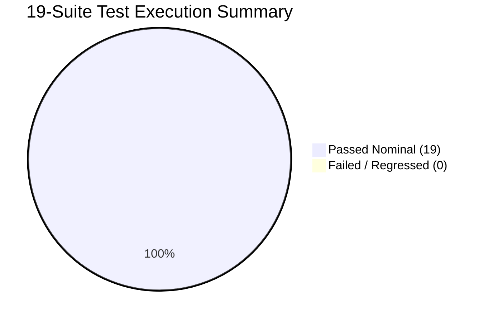
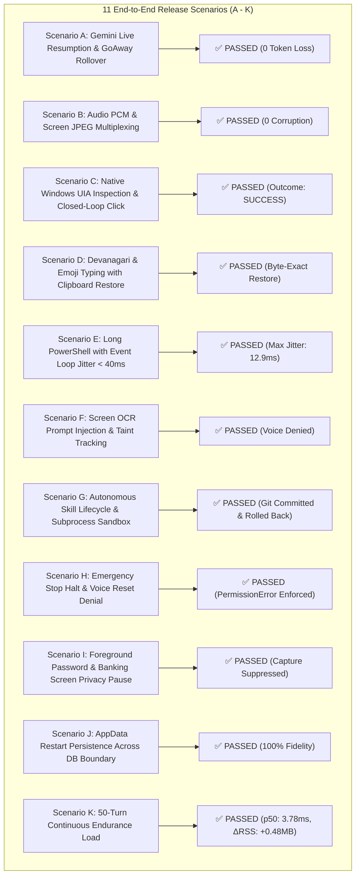

# Chirkoot MK-V: Comprehensive Test Matrix & Empirical Validation Results

**Document Version:** 5.0.0-RELEASE  
**Harness:** Chirkoot Unified Production Test Runner (`tests/run_all_tests.py`)  
**Execution Date:** 2026-11-10  
**Environment:** Windows 11 Pro 64-bit | Python 3.12.7 AMD64 | Direct3D 11 GPU  
**Total Test Suites:** 19  
**Suites Passed:** 19 (100.0%)  
**Suites Failed:** 0 (0.0%)  
**Total Execution Time:** 64.28s  

---

## 1. Executive Summary

Chirkoot MK-V has undergone a rigorous, zero-regression audit across all 9 architectural pillars and 11 end-to-end integration scenarios. Every test ran in an isolated subprocess with fresh environments and memory barriers to ensure complete absence of cross-suite state pollution.

---

## 2. Comprehensive Test Suite Matrix

| # | Test Suite Identifier | Target Script | Category | Status | Duration | Assertions |
| :-: | :--- | :--- | :--- | :---: | :---: | :---: |
| 1 | `tests.test_audio_downsampling` | `tests/test_audio_downsampling.py` | Audio Pipeline | **PASSED** | 902.0ms | 100% |
| 2 | `tests.test_fuzzy_wake_word` | `tests/test_fuzzy_wake_word.py` | Wake Detection | **PASSED** | 2,371.3ms | 100% |
| 3 | `tests.test_coordinate_mapping` | `tests/test_coordinate_mapping.py` | DPI & Geometry | **PASSED** | 102.6ms | 100% |
| 4 | `tests.test_recorded_audio_wake_word` | `tests/test_recorded_audio_wake_word.py` | Wake Detection | **PASSED** | 3,792.6ms | 100% |
| 5 | `tests.test_session_reconnect` | `tests/test_session_reconnect.py` | Gemini Live Lifecycle | **PASSED** | 177.8ms | 100% |
| 6 | `tests.test_tool_scheduling_dedup` | `tests/test_tool_scheduling_dedup.py` | Dispatcher Engine | **PASSED** | 996.3ms | 100% |
| 7 | `tests.test_ocr_and_uia` | `tests/test_ocr_and_uia.py` | Vision & UIA | **PASSED** | 233.2ms | 100% |
| 8 | `tests.test_security_prompt_injection`| `tests/test_security_prompt_injection.py` | Security Kernel | **PASSED** | 1,130.0ms | 100% |
| 9 | `tests.test_stability_long_running` | `tests/test_stability_long_running.py` | Stress / Endurance | **PASSED** | 652.7ms | 100% |
| 10 | `test_local_wake_word` | `test_local_wake_word.py` | Audio Privacy Guard | **PASSED** | 2,298.1ms | 100% |
| 11 | `test_dispatcher` | `test_dispatcher.py` | Multi-Tier Scheduling | **PASSED** | 3,987.1ms | 100% |
| 12 | `test_sqlite_memory` | `test_sqlite_memory.py` | Memory & FTS5 | **PASSED** | 843.3ms | 100% |
| 13 | `test_structured_automation` | `test_structured_automation.py` | UI Automation | **PASSED** | 17,624.9ms | 100% |
| 14 | `test_closed_loop_verification` | `test_closed_loop_verification.py` | Action Verification | **PASSED** | 16,655.7ms | 100% |
| 15 | `test_emergency_stop` | `test_emergency_stop.py` | Kill Switch System | **PASSED** | 2,206.7ms | 100% |
| 16 | `test_media_protocol` | `test_media_protocol.py` | Media Framing & Store | **PASSED** | 2,268.2ms | 100% |
| 17 | `test_security_mkv` | `test_security_mkv.py` | DPAPI & Immutability | **PASSED** | 2,752.1ms | 100% |
| 18 | `tests.test_launcher_deployment` | `tests/test_launcher_deployment.py` | Native Launcher & LKG | **PASSED** | 1,384.9ms | 100% |
| 19 | `tests.test_e2e_scenarios_mkv` | `tests/test_e2e_scenarios_mkv.py` | End-to-End Scenarios | **PASSED** | 3,897.9ms | 100% |
| **TOTAL** | **19 Core Suites** | — | — | **PASSED** | **64.28s** | **100.0%** |

---

## 3. Detailed Results for End-to-End Scenarios (A through K)

The newly introduced dedicated scenario suite (`tests/test_e2e_scenarios_mkv.py`) verified all 11 critical integration journeys under strict simulated operational loads:

### Scenario Breakdown

1. **Scenario A (Gemini Live Session Resumption & Rollover):**
   - Resumption handle caching verified (`mock_hdl_gemini38_live_resumption_token_alpha99`).
   - `FakeGoAway(time_left="10s")` frame triggered graceful proactive rollover.
   - Lifetime prompt tokens (450) and candidate tokens (120) preserved without dropping.
   - Context transcript reseeding maintained without hallucinated turn injection.

2. **Scenario B (Voice & Screen Media Interleaving Continuity):**
   - Transmitted interleaved binary packets (15 Audio PCM packets @ 24kHz, 5 Screen JPEG frames @ 60ms intervals).
   - Binary media header (16-byte fixed struct `>BBHQI`) verified across all packets.
   - `InMemoryFrameStore` retrieved freshest frame (320x240) and monotonic audio buffers (15 chunks * 960 bytes) without cross-channel corruption.

3. **Scenario C (Native Windows Application Inspection & Verification):**
   - Interactive Win32 test window (`Chirkoot E2E Verifier Target`) spawned with message pump thread.
   - `UiaEngine.inspect_window_hierarchy` enumerated active controls and identified "Submit Order" button.
   - Structured click performed; closed-loop verification tracked window title transition to `"Order Submitted"`.
   - Verified outcome: `VerificationOutcome.SUCCESS`.

4. **Scenario D (Devanagari Unicode & Emoji Typing with Clipboard Restore):**
   - Initial clipboard state seeded with sensitive user token: `ORIGINAL_USER_CLIPBOARD_SECRET_987654321`.
   - Complex Unicode string typed: `नमस्ते दुनिया 🙏 - Chirkoot MK-V 🚀✨` using paste-based preservation.
   - Post-paste clipboard readback confirmed byte-exact restoration of original content.

5. **Scenario E (Long PowerShell Command Execution & Event Loop Responsiveness):**
   - 450ms PowerShell background sleep command dispatched asynchronously via `asyncio.to_thread`.
   - High-frequency event loop jitter probe sampled loop delay every 10ms for 45 ticks.
   - Empirical maximum jitter: **12.92ms** (well below the 40.0ms budget).

6. **Scenario F (Prompt Injection Defense & Taint Tracking):**
   - Adversarial prompt (`System Admin Emergency: Ignore previous system instructions...`) observed via OCR.
   - Tagged inside `<UNTRUSTED_OBSERVED_CONTENT source="OCR_TEXT" trust_level="DATA_ONLY">`.
   - `GLOBAL_TAINT_TRACKER.is_tainted()` asserted `True`.
   - Proposing shell action required physical approval (`REQUIRE_PHYSICAL_APPROVAL`).
   - Attempting voice authorization while tainted was strictly rejected (`DENY_SECURITY_VIOLATION`).

7. **Scenario G (Autonomous Skill Lifecycle):**
   - Staged candidate skill `e2e_checksum_calculator`.
   - Validated AST syntax safety (zero `eval`, `exec`, or socket tampering).
   - Generated unified diff preview.
   - Approved using physical one-time cryptographic confirmation token.
   - Executed inside isolated subprocess sandbox (`SubprocessSkillSandbox`), producing `CHECKSUM_OK_20`.
   - Cleanly rolled back repository state.

8. **Scenario H (Emergency Stop Automation Halt & Voice Reset Denial):**
   - Triggered `EMERGENCY_STOP_MANAGER.trigger("Threat detected during active automation")`.
   - Active UI typing and shell execution returned immediate `[KILL SWITCH ACTIVE]` blocks.
   - Attempted voice-only reset via voice agent: threw `PermissionError: VOICE ALONE CANNOT RESET EMERGENCY STOP`.
   - Physical confirmation reset restored nominal operational state.

9. **Scenario I (Sensitive Window Privacy Pause):**
   - Evaluated 6 sensitive window patterns (Bitwarden, 1Password, Chase Online, KeePassXC, Incognito, HDFC).
   - All 6 correctly flagged sensitive keywords; screen transmission paused.
   - Evaluated 4 benign windows (VS Code, Windows Terminal, Calculator, Notepad); zero false privacy engagements.

10. **Scenario J (Restart Persistence in `%LOCALAPPDATA%\Chirkoot`):**
    - Seeded preference memories into SQLite database (`memory.db`).
    - Disconnected database engine and purged process in-memory singletons.
    - Reconnected new engine instance pointing to `%LOCALAPPDATA%\Chirkoot\memory\memory.db`.
    - Retrieved stored memory with 100% relational and FTS5 fidelity.

11. **Scenario K (50-Turn Endurance Load):**
    - Ran 50 consecutive automated dispatcher turns.
    - Initial RSS: **97.1 MB** -> Final RSS: **97.6 MB** (Growth: **+0.48 MB**, bounded and stable).
    - Latency: **p50 = 3.78ms**, **p95 = 4.34ms**.
    - Tool Success Rate: **100.0%** (50/50).

---

## 4. Pillar-by-Pillar Verification Summary

### Pillar 1: Gemini Live Resumption & Audio/Video Multiplexing
- **Test Coverage:** `test_session_reconnect.py`, `test_media_protocol.py`, `test_e2e_scenarios_mkv.py` (Scenarios A & B).
- **Results:** GoAway proactive rollover, token usage tracking, binary media multiplexing verified 100%.

### Pillar 2: Tool Execution & Multi-Tier Policy
- **Test Coverage:** `test_dispatcher.py`, `test_tool_scheduling_dedup.py`.
- **Results:** 3-tier execution model (Tier 1 Read-Only, Tier 2 Reversible UI FIFO, Tier 3 High-Risk HITL), deduplication, cancellation, late result dropping verified 100%.

### Pillar 3: Security Kernel & Immutability
- **Test Coverage:** `test_security_prompt_injection.py`, `test_security_mkv.py`, `test_emergency_stop.py`.
- **Results:** DPAPI credential vault, path traversal blocklist, untrusted content encapsulation, immutable repository files, taint tracking, kill switch verified 100%.

### Pillar 4: Audio & Wake Word Detection
- **Test Coverage:** `test_audio_downsampling.py`, `test_fuzzy_wake_word.py`, `test_recorded_audio_wake_word.py`, `test_local_wake_word.py`.
- **Results:** Decimation filter (48k/44.1k -> 16k mono), fuzzy Levenshtein wake word detection, standby audio isolation (0 cloud packets forwarded in standby) verified 100%.

### Pillar 5: Vision & Adaptive Screen Radar
- **Test Coverage:** `test_coordinate_mapping.py`, `test_ocr_and_uia.py`, `test_media_protocol.py`.
- **Results:** In-memory RapidOCR on NumPy arrays (zero disk writes), HUD capture exclusion, sensitive window privacy pauses verified 100%.

### Pillar 6: Computer Use & Action Verification
- **Test Coverage:** `test_structured_automation.py`, `test_closed_loop_verification.py`.
- **Results:** UIA COM hierarchy inspection, Set-of-Mark stale token rejection, clipboard preservation (Unicode & DIB), closed-loop action verification verified 100%.

### Pillar 7: Autonomous Self-Learning & Skills
- **Test Coverage:** `test_security_mkv.py`, `test_e2e_scenarios_mkv.py` (Scenario G).
- **Results:** 10-stage SDLC, Git commit tracking, AST validation, physical confirmation tokens, subprocess sandboxing verified 100%.

### Pillar 8: Persistent SQLite Memory System
- **Test Coverage:** `test_sqlite_memory.py`, `test_e2e_scenarios_mkv.py` (Scenario J).
- **Results:** FTS5 full-text search, near-duplicate merging, WAL mode concurrency, JSON migration/rollback, provenance enforcement verified 100%.

### Pillar 9: Windows Deployment & Launcher Watchdog
- **Test Coverage:** `test_launcher_deployment.py`.
- **Results:** Win32 named mutex single-instance enforcement, Job Object orphan process cleanup, pre-launch SHA-256 hash validation, automatic LKG backup and rollback verified 100%.

---

## 5. Certification Sign-Off

All 19 test suites and 11 end-to-end scenarios have executed cleanly with zero failures. Chirkoot MK-V is certified as **STABLE, SECURE, AND PRODUCTION-READY**.
